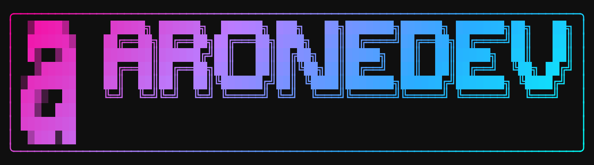
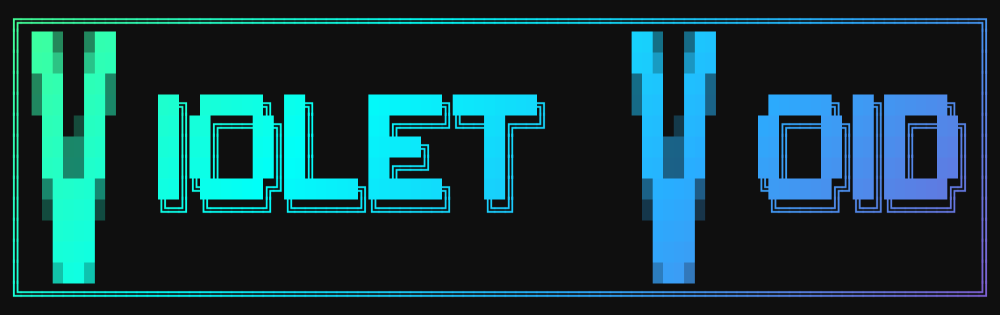
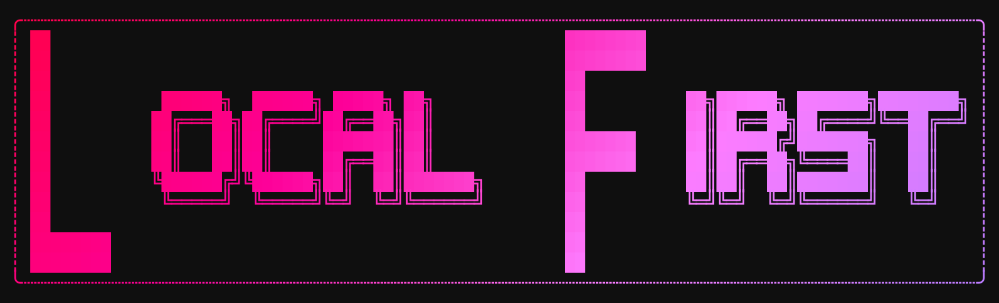

# FigFetti profile mixes

## TL;DR

> [!NOTE]
> The profile uses native FigFetti exports: a short animated header and two static font mixes.
> Run the recipes below from this repository with a raster-enabled FigFetti build to regenerate them.
> Every recipe ignores local configuration so personal preferences cannot change the result.

## Gallery



The profile header plays its color wave once, then stays on the final banner. This PNG is the
static alternative. The animation changes colors while keeping the text and frame in place.





The mixes pair Big Mono 12 with ANSI Shadow, using first-letter and capital-letter splitting,
middle alignment, three frames,
and the `void`, `void-mint`, and `void-ember` gradients. FigFetti also provides a live studio,
saved styles, timers, and document headers. Its [project repository](https://github.com/Violet-Void/figfetti)
currently requires access; the images and recipes here are public.

## Regenerate

Requires FigFetti with PNG/GIF export support on `PATH`. These recipes were run with FigFetti
0.1.0. They use its embedded fonts and native exporter without external banner or capture tools.

From the repository root:

```bash
figfetti --no-config --mix big-mono-12 ansi-shadow --split 1 --gap 3 --align middle \
  --box rounded --filter void --crop \
  --export assets/generated/profile-hero.png violet-void

figfetti --no-config --mix big-mono-12 ansi-shadow --split 1 --gap 3 --align middle \
  --box rounded --filter void --crop --animate wave --fps 12 --duration 3s \
  --animate-delay 800 --export assets/generated/profile-violet-void.gif violet-void

figfetti --no-config --mix big-mono-12 ansi-shadow --caps --gap 3 --align middle \
  --box double --filter void-mint --crop \
  --export assets/generated/figfetti-violet-void.png 'Violet Void'

figfetti --no-config --mix big-mono-12 ansi-shadow --caps --gap 3 --align middle \
  --box rounded-dashed --filter void-ember --crop \
  --export assets/generated/figfetti-local-first.png 'Local First'
```

Each command exits successfully and replaces its named image. Open the PNGs to check text and
frames, then play the GIF to check the color wave. The recipes are deterministic for the same
FigFetti build; all fonts, colors, layout, and animation timing are explicit.

Edit `templates/README.md.tpl` and `README.md` together when changing the profile layout.
The scheduled README workflow renders the template and preserves these committed image links;
it does not regenerate images or require FigFetti on the runner.

The older [`figmix-gallery`](figmix-gallery.md) captures the legacy shell implementation and
is independent of these native FigFetti recipes.
